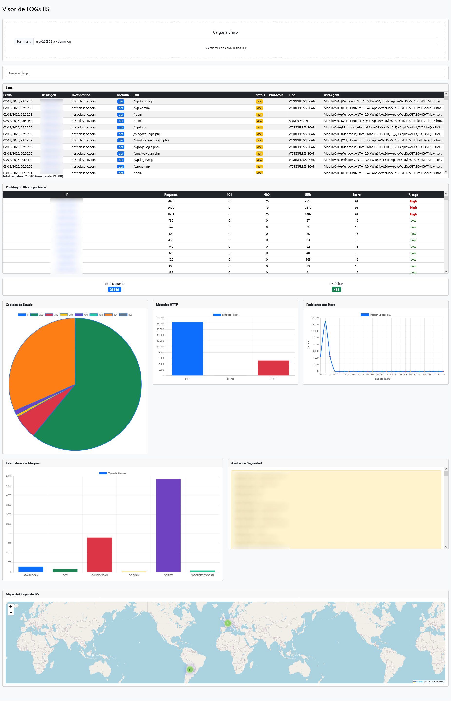
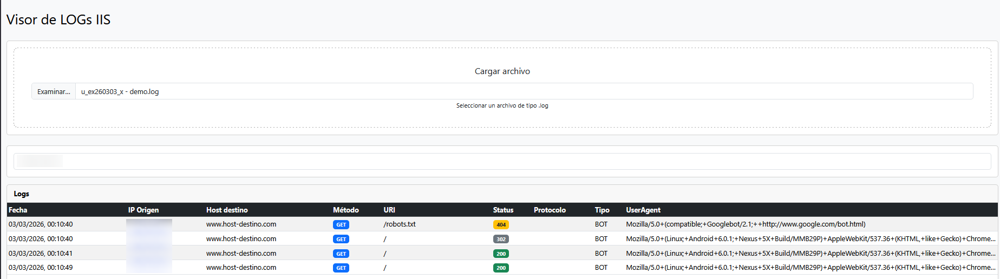

# Analizador de Logs IIS (Client-Side)

🇪🇸 Español | 🇬🇧 [English](README.md)

Herramienta web para analizar archivos de logs de **Microsoft IIS** directamente en el navegador.
Permite visualizar métricas, detectar patrones de ataque y explorar registros sin necesidad de subir archivos a un servidor.

Todo el procesamiento se realiza **del lado del cliente (JavaScript)**.

## Características

* Análisis de archivos de log de IIS
* Procesamiento **100% en el navegador**
* Visualización de métricas mediante gráficos
* Tabla interactiva de registros
* Filtro rápido por IP
* Identificación automática de:

  * Bots
  * Scanners
  * Posibles ataques
  * IP privadas no son tomadas en cuenta para los análisis
* Ranking de IPs
* Detección de posibles ataques de fuerza bruta
* Mapa de origen de tráfico

## Gráficos disponibles

* Distribución de **códigos de estado HTTP**
* Distribución de **métodos HTTP**
* **Peticiones legítimas por hora**: mide el uso real del sistema, por lo que excluye el tráfico detectado como ataque, escaneo, bot o script y las respuestas que no sean 2xx/3xx. Muestra cuántas peticiones se consideraron (ej. "12.400 de 16.151 (77 %)"). Los demás gráficos siguen usando todo el tráfico.
* Tipos de **ataques detectados**

Los gráficos se generan utilizando **Chart.js**.

## Formato de log soportado

Logs generados por **Microsoft IIS** con el formato estándar W3C.

Ejemplo:

```
#Fields: date time s-ip cs-method cs-uri-stem cs-uri-query s-port cs-username c-ip cs(User-Agent) sc-status sc-substatus sc-win32-status time-taken
2026-03-07 10:15:32 192.168.1.10 GET /index.html - 80 - 203.0.113.15 Mozilla/5.0 200 0 0 45
```

## Uso

1. Abrir la página en el navegador
2. Seleccionar uno o más archivos de log de IIS (`.log` o `.txt`); varios archivos se fusionan por fecha
3. El sistema procesará el/los archivo(s) automáticamente
4. Se mostrarán:

* métricas
* gráficos
* registros del log

## Filtrado

Es posible filtrar registros mediante (todo combinable):

* campo de búsqueda (con debounce; el índice se construye la primera vez que se usa)
* selectores de método HTTP, código de estado y **tipo detectado**
* **rango de fechas** (Desde / Hasta)
* click sobre una IP en la tabla o en el ranking

El resumen, los gráficos, el ranking de IPs, las alertas, las URIs lentas y los errores 5xx siguen los filtros activos. La tabla está **paginada** (100 / 250 / 500 / 1000 filas por página).

## Zona horaria

Las fechas se guardan en UTC (valor por defecto de IIS). El **selector de zona horaria** alterna entre la hora local del navegador y UTC en la tabla, el gráfico por hora y los filtros de fecha.

## Reportes adicionales

* **URIs más lentas** (promedio / máximo en ms) si el log incluye `time-taken`
* **URIs con más errores 5xx**

## Exportación

* Registros filtrados a **CSV** o **JSON** (fechas en ISO UTC)
* Ranking de IPs a **CSV**

Las celdas CSV que empiezan con `=`, `+`, `-` o `@` se prefijan con una comilla simple para evitar inyección de fórmulas en planillas a partir de contenido malicioso del log.

## Modo oscuro

Botón en el encabezado. Por defecto sigue la preferencia del sistema y recuerda tu elección.

## Detección de ataques

La detección analiza la URI **y la query string** (`cs-uri-query`), tanto en texto crudo como decodificado:

* SQL injection, XSS, path traversal e intentos de exploit (ej. `${jndi:`, `/etc/passwd`)
* User-Agents de herramientas de seguridad (sqlmap, nikto, nmap, ...)
* Descubrimiento de archivos sensibles, paneles admin, WordPress y bases de datos
* Bots y scripts (curl, wget, python, ...)
* Fuerza bruta: al menos 20 **logins fallidos** (`401.1`) desde la misma IP en 5 minutos. El `401.2` (desafío de autenticación de Windows, normal en intranets con autenticación integrada) se ignora. Si el log no tiene el campo `sc-substatus`, todo `401` cuenta como login fallido.

La detección es heurística y puede generar falsos positivos o negativos.

## Ranking de IPs por riesgo

Solo se rankean IPs públicas. Cada IP recibe un score y un nivel de riesgo (Low / Medium / High) con una columna de **motivos** que lo explica:

| Señal | Puntos |
| --- | --- |
| Intento de exploit | 50 |
| SQL injection / XSS / path traversal | 40 cada tipo |
| User-Agent de herramienta de seguridad | 30 |
| Escaneo de configuración / base de datos | 15 cada tipo |
| Escaneo de WordPress / paneles admin | 10 cada tipo |
| Script (curl, python, ...) | 5 |
| Bot | 0 (informativo) |
| Muchas URIs distintas con 404 y ≥ 30 % de errores (firma de escáner) | 1 cada 3 URIs, hasta 30 |
| Errores repetidos | 1 cada 10, hasta 10 |
| Sondeo de accesos (403 = 2, login fallido = 3) | hasta 30 |
| Fuerza bruta | 40 |

* **High**: score ≥ 50, **o cualquier ataque real** (exploit, SQLi, XSS, path traversal) **o fuerza bruta**, sin importar el score.
* **Medium**: score ≥ 20.
* El volumen de requests por sí solo nunca sube el score, y un bot que repite el mismo 404 no se marca como ataque.

Todos los pesos y umbrales son constantes (`SCORING`, `BRUTEFORCE_*`) al inicio de `js/analysis.js`.

## Rendimiento

* el parseo corre en un **Web Worker** (la UI sigue respondiendo); los archivos se leen en trozos de 8 MB, por lo que no hay límite de tamaño de un único string
* respaldo automático: si el Worker no está disponible se parsea en el hilo principal
* tabla paginada (solo una página de filas en el DOM)
* los strings repetidos (user agent, host, ...) se comparten en memoria
* análisis en una sola pasada para ranking, alertas, fuerza bruta, URIs lentas y 5xx
* índice de búsqueda perezoso y búsqueda con debounce

Referencia (log sintético de 600k líneas / 73 MB, Chrome): ~5 s de carga, ~0,7 s para la primera búsqueda de texto, ~80 MB de heap JS.

## Tecnologías utilizadas

* HTML5, CSS, JavaScript (sin build; se abre `index.html` directamente)
* Bootstrap 5
* Chart.js
* Leaflet (+ markercluster, heat)
* GeoJS (API de geolocalización, solo al cargar el mapa)

## Estructura del proyecto

```
index.html        página y layout
style.css         estilos (claro / oscuro)
js/utils.js       escape de HTML, IPs privadas, helpers CSV
js/detect.js      detección de ataques / scanners / bots
js/parser.js      parser de logs W3C (por trozos, apto para worker)
js/analysis.js    ranking, alertas, fuerza bruta, URIs lentas, 5xx
js/loader.js      carga con Web Worker + respaldo
js/charts.js      gráficos con Chart.js
js/map.js         mapa Leaflet, consulta a GeoJS y caché
js/app.js         controlador de UI (eventos, filtros, tabla, exportación, tema)
js/version.js     versión de la app que se muestra en el pie de página
tests/            tests automáticos (Node)
```

Los scripts son archivos `<script>` clásicos (no ES modules) para que la página funcione abierta desde disco (`file://`).

## Versionado

La versión en uso se muestra en el pie de la página (útil en GitHub Pages) y sigue [versionado semántico](https://semver.org/lang/es/). Para publicar una versión:

1. Subir la versión en **ambos** `js/version.js` y `package.json` (`npm test` falla si difieren).
2. Commitear y etiquetar: `git tag vX.Y.Z` y `git push --tags` (opcionalmente crear un release en GitHub con las notas).

## Tests

```
npm test
```

Usa el test runner integrado de Node (18+), sin dependencias. Cubre detección, parseo, análisis y utilidades.

## Seguridad

Los archivos de log **no se envían a ningún servidor**.
Todo el análisis se realiza localmente en el navegador del usuario.

La única excepción es el **mapa de origen**, que es **opt-in**: solo al pulsar *Cargar mapa*, las IPs públicas de los 100 clientes más activos (las privadas nunca se envían) se consultan contra la API de terceros [GeoJS](https://www.geojs.io/). El contenido del log (URIs, User-Agents, etc.) nunca se envía. Los resultados se guardan en el `localStorage` del navegador por 30 días para evitar consultas repetidas.

Todo dato proveniente del log se escapa como HTML antes de mostrarse, por lo que peticiones maliciosas presentes en un log no pueden ejecutar código en el visor.

## Limitaciones

* todo el log parseado se mantiene en memoria: logs muy grandes (varios millones de líneas) dependen de la memoria disponible del navegador
* la detección es heurística (ver arriba)
* la búsqueda de texto no coincide con la fecha formateada; usar el filtro por rango de fechas

## Posibles mejoras futuras

* análisis por país
* reglas de detección y umbral de fuerza bruta configurables
* tabla de logs virtualizada y reportes descargables

## Screenshots

### Vista general

### Tabla de logs

### Filtro por IP


## Notas

Algunas partes de este proyecto fueron desarrolladas con la asistencia de herramientas de IA para generar y mejorar fragmentos de código y documentación.

## Licencia

MIT License
