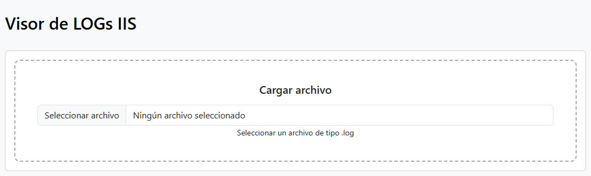

# IIS Log Analyzer (Client-Side)

🇪🇸 Español | 🇬🇧 [English](README.md)

Herramienta web para analizar archivos de logs de **Microsoft IIS** directamente en el navegador.
Permite visualizar métricas, detectar patrones de ataque y explorar registros sin necesidad de subir archivos a un servidor.

Todo el procesamiento se realiza **del lado del cliente (JavaScript)**.

## Características

* Análisis de archivos de log de IIS
* Procesamiento **100% en el navegador**
* Visualización de métricas mediante gráficos
* Tabla interactiva de registros
* Filtro rápido por IP
* Identificación automática de:

  * Bots
  * Scanners
  * Posibles ataques
  * IP privadas no son tomadas en cuenta para los análisis
* Ranking de IPs
* Detección de posibles ataques de fuerza bruta
* Mapa de origen de tráfico

## Gráficos disponibles

* Distribución de **códigos de estado HTTP**
* Distribución de **métodos HTTP**
* **Peticiones por hora**
* Tipos de **ataques detectados**

Los gráficos se generan utilizando **Chart.js**.

## Formato de log soportado

Logs generados por **Microsoft IIS** con el formato estándar W3C.

Ejemplo:

```
#Fields: date time s-ip cs-method cs-uri-stem cs-uri-query s-port cs-username c-ip cs(User-Agent) sc-status sc-substatus sc-win32-status time-taken
2026-03-07 10:15:32 192.168.1.10 GET /index.html - 80 - 203.0.113.15 Mozilla/5.0 200 0 0 45
```

## Uso

1. Abrir la página en el navegador
2. Seleccionar uno o más archivos de log de IIS (`.log` o `.txt`); varios archivos se fusionan por fecha
3. El sistema procesará el/los archivo(s) automáticamente
4. Se mostrarán:

* métricas
* gráficos
* registros del log

## Filtrado

Es posible filtrar registros mediante:

* campo de búsqueda (con debounce)
* selectores de método HTTP y código de estado (combinables con la búsqueda)
* click sobre una IP en la tabla o en el ranking

El resumen y los gráficos siguen los filtros activos. El ranking de IPs, las alertas y el mapa usan siempre el log completo.

## Detección de ataques

La detección analiza la URI **y la query string** (`cs-uri-query`), tanto en texto crudo como decodificado:

* SQL injection, XSS, path traversal e intentos de exploit (ej. `${jndi:`, `/etc/passwd`)
* User-Agents de herramientas de seguridad (sqlmap, nikto, nmap, ...)
* Descubrimiento de archivos sensibles, paneles admin, WordPress y bases de datos
* Bots y scripts (curl, wget, python, ...)
* Fuerza bruta: más de 20 respuestas `401` desde la misma IP

La detección es heurística y puede generar falsos positivos o negativos.

## Rendimiento

Optimizaciones implementadas:

* parseo en bloques que ceden el hilo a la UI, con indicador de progreso
* cadenas de búsqueda precalculadas y búsqueda con debounce
* reutilización de `Intl.DateTimeFormat`
* tabla renderizada en una sola pasada (hasta 20.000 filas)
* destrucción de instancias de gráficos

## Tecnologías utilizadas

* HTML5
* CSS
* JavaScript
* Bootstrap
* Chart.js
* GeoJS (Geolocation lookup API)

## Seguridad

Los archivos de log **no se envían a ningún servidor**.
Todo el análisis se realiza localmente en el navegador del usuario.

La única excepción es el **mapa de origen**: las IPs públicas de los 100 clientes más activos (las privadas nunca se envían) se consultan contra la API de terceros [GeoJS](https://www.geojs.io/) para obtener su ubicación. El contenido del log (URIs, User-Agents, etc.) nunca se envía. Si no querés compartir esas IPs, no uses el mapa (por ejemplo, bloqueando la request).

Todo dato proveniente del log se escapa como HTML antes de mostrarse, por lo que peticiones maliciosas presentes en un log no pueden ejecutar código en el visor.

## Limitaciones

Debido a limitaciones del navegador:

* archivos extremadamente grandes (>1M líneas) pueden requerir optimizaciones adicionales
* el rendimiento depende de la memoria disponible en el navegador

## Posibles mejoras futuras

* mejoras en el rendimiento (para archivos de muchos registros)
* análisis por país
* detección de patrones de ataque más avanzados
* filtros más complejos
* mover el parseo a un Web Worker

## Screenshots

### Vista general

### Tabla de logs

### Filtro por IP


## Notas

Algunas partes de este proyecto fueron desarrolladas con la asistencia de herramientas de IA para generar y mejorar fragmentos de código y documentación.

## Licencia

MIT License
