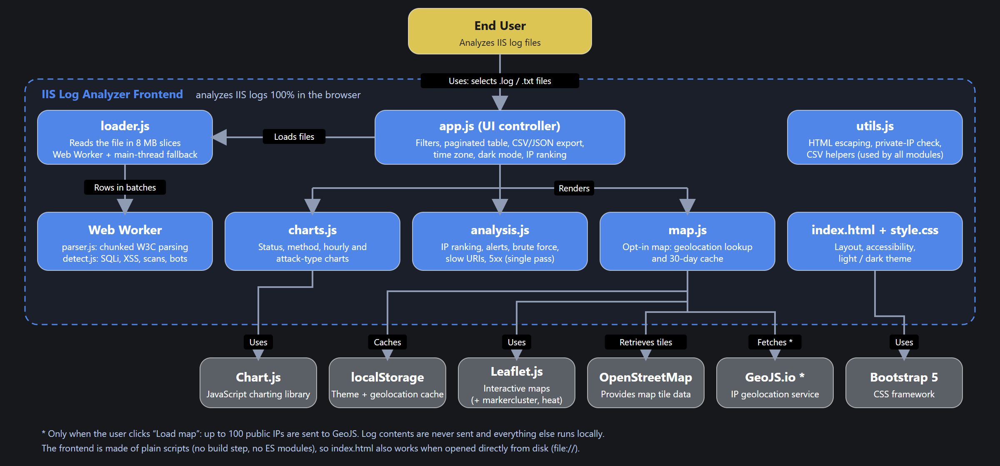
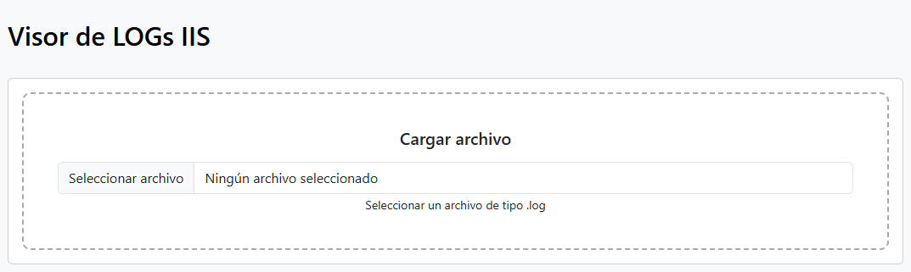
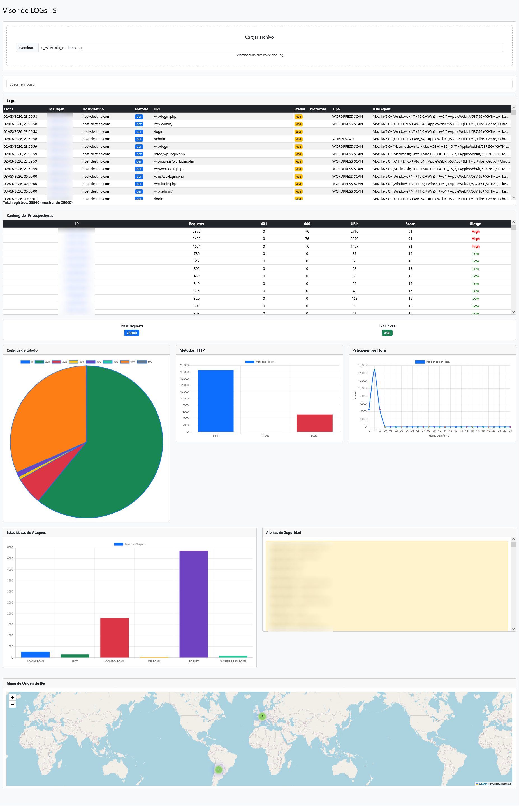
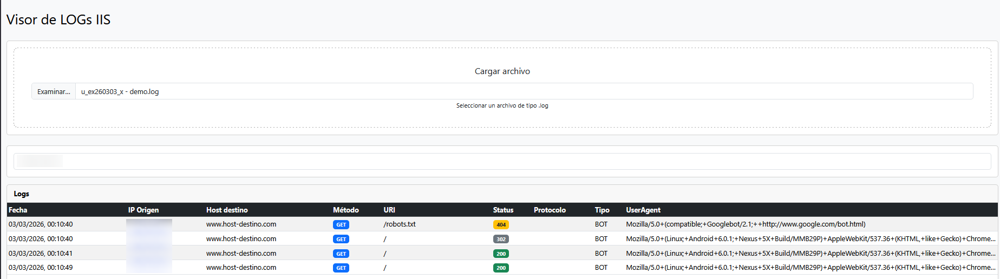

# IIS Log Analyzer (Client-Side)

🇬🇧 English | 🇪🇸 [Español](README.es.md)

A web tool to analyze **Microsoft IIS log files** directly in the browser.
It allows visualizing metrics, detecting attack patterns, and exploring log records without uploading files to a server.

All processing is done **client-side (JavaScript)**.

## Features

* IIS log file analysis
* **100% browser-based processing**
* Metrics visualization using charts
* Interactive log table
* Quick IP filtering
* Automatic identification of:

  * Bots
  * Scanners
  * Possible attacks
  * Private IPs are excluded from analysis
* IP ranking
* Detection of possible brute force attacks
* Traffic origin map

## Available Charts

* **HTTP status code** distribution
* **HTTP method** distribution
* **Legitimate requests per hour**: measures real system usage, so it excludes traffic detected as attacks, scans, bots or scripts and responses other than 2xx/3xx. It shows how many requests were considered (e.g. "12,400 of 16,151 (77 %)"). The other charts keep using all traffic.
* Detected **attack types**

Charts are generated using **Chart.js**.

## Supported Log Format

Logs generated by **Microsoft IIS** using the standard **W3C log format**.

Example:

```
#Fields: date time s-ip cs-method cs-uri-stem cs-uri-query s-port cs-username c-ip cs(User-Agent) sc-status sc-substatus sc-win32-status time-taken
2026-03-07 10:15:32 192.168.1.10 GET /index.html - 80 - 203.0.113.15 Mozilla/5.0 200 0 0 45
```

## Usage

1. Open the page in your browser
2. Select one or more IIS log files (`.log` or `.txt`); multiple files are merged by date
3. The system will automatically process the file(s)
4. The following will be displayed:

* metrics
* charts
* log records

## Filtering

Log records can be filtered using (all combinable):

* search field (debounced; the search index is built lazily on first use)
* HTTP method, status code and **detected type** selectors
* **date range** (From / To)
* clicking an IP address in the table or in the ranking

Summary, charts, IP ranking, security alerts, slow URIs and 5xx tables all follow the active filters. The table is **paginated** (100 / 250 / 500 / 1000 rows per page).

## Time zone

Dates are stored in UTC (IIS default). The **time zone selector** switches the table, the hourly chart and the date filters between the browser's local time and UTC.

## Extra reports

* **Slowest URIs** (average / max ms) when the log includes `time-taken`
* **URIs with the most 5xx errors**

## Export

* Filtered log records to **CSV** or **JSON** (dates in ISO UTC)
* IP ranking to **CSV**

CSV cells that start with `=`, `+`, `-` or `@` are prefixed with a single quote to prevent spreadsheet formula injection from malicious log content.

## Dark mode

Toggle in the header. It follows the system preference by default and remembers your choice.

## Attack Detection

Detection runs over the URI **and the query string** (`cs-uri-query`) using the raw and URL-decoded text:

* SQL injection, XSS, path traversal and exploit attempts (e.g. `${jndi:`, `/etc/passwd`)
* Security tool user agents (sqlmap, nikto, nmap, ...)
* Sensitive file / admin / WordPress / database panel discovery
* Bots and scripts (curl, wget, python, ...)
* Brute force: at least 20 **failed logins** (`401.1`) from the same IP within 5 minutes. `401.2` (the Windows authentication challenge, normal on intranets with integrated auth) is ignored. If the log has no `sc-substatus` field, every `401` counts as a failed login.

Detection is heuristic and may produce false positives or negatives.

## IP risk ranking

Only public IPs are ranked. Each IP gets a score and a risk level (Low / Medium / High) with a **reasons** column explaining it:

| Signal | Points |
| --- | --- |
| Exploit attempt | 50 |
| SQL injection / XSS / path traversal | 40 each type |
| Security tool user agent | 30 |
| Config / DB scan | 15 each type |
| WordPress / admin scan | 10 each type |
| Script (curl, python, ...) | 5 |
| Bot | 0 (informational) |
| Many distinct URIs with 404 and ≥ 30 % errors (scanner signature) | 1 per 3 URIs, up to 30 |
| Repeated errors | 1 per 10, up to 10 |
| Access probing (403 = 2, failed login = 3) | up to 30 |
| Brute force | 40 |

* **High**: score ≥ 50, **or any real attack** (exploit, SQLi, XSS, path traversal) **or brute force**, whatever the score.
* **Medium**: score ≥ 20.
* Request volume alone never raises the score, and a bot repeating the same 404 is not flagged as an attack.

All weights and thresholds are constants (`SCORING`, `BRUTEFORCE_*`) at the top of `js/analysis.js`.

## Performance

* parsing runs in a **Web Worker** (the UI stays responsive); files are read in 8 MB slices, so there is no single-string size limit
* automatic fallback to main-thread parsing if the Worker is unavailable
* paginated table (only one page of rows in the DOM)
* repeated strings (user agent, host, ...) are shared in memory
* single-pass analysis for ranking, alerts, brute force, slow URIs and 5xx
* lazy search index and debounced search

Reference (synthetic log, 600k lines / 73 MB, Chrome): ~5 s to load, ~0.7 s for the first full-text search, ~80 MB of JS heap.

## Technologies Used

* HTML5, CSS, JavaScript (no build step; open `index.html` directly)
* Bootstrap 5
* Chart.js
* Leaflet (+ markercluster, heat)
* GeoJS (geolocation lookup API, only when the map is loaded)

## Project structure

```
index.html        page and layout
style.css         styles (light / dark)
js/utils.js       escaping, private IPs, CSV helpers
js/detect.js      attack / scanner / bot detection
js/parser.js      W3C log parser (chunked, worker-safe)
js/analysis.js    ranking, alerts, brute force, slow URIs, 5xx
js/loader.js      Web Worker loading + fallback
js/charts.js      Chart.js rendering
js/map.js         Leaflet map, GeoJS lookup and cache
js/app.js         UI controller (events, filters, table, export, theme)
js/version.js     app version shown in the page footer
tests/            automated tests (Node)
```

Scripts are plain `<script>` files (not ES modules) so the page works when opened from disk (`file://`).

## Versioning

The running version is shown in the page footer (useful on GitHub Pages) and follows [semantic versioning](https://semver.org/). To release:

1. Bump the version in **both** `js/version.js` and `package.json` (`npm test` fails if they differ).
2. Commit, then tag it: `git tag vX.Y.Z` and `git push --tags` (optionally create a GitHub release with the notes).

## Tests

```
npm test
```

Uses the built-in Node test runner (Node 18+), no dependencies. Covers detection, parsing, analysis and utilities.

## Security

Log files **are not sent to any server**.
All analysis is performed locally in the user's browser.

The only exception is the **origin map**, which is **opt-in**: only when you click *Load map*, the public IP addresses of the 100 most active clients (private IPs are never sent) are queried against the third-party [GeoJS](https://www.geojs.io/) API. Log contents (URIs, user agents, etc.) are never sent. Results are cached in the browser's `localStorage` for 30 days to avoid repeated requests.

All log-derived data is HTML-escaped before rendering, so malicious requests present in a log cannot execute code in the viewer.

## Limitations

* the whole parsed log is kept in memory: very large logs (several million lines) depend on the available browser memory
* detection is heuristic (see above)
* free-text search does not match the formatted date; use the date range filter instead

## Possible Future Improvements

* country-based traffic analysis
* configurable detection rules and brute-force threshold
* virtualized log table and downloadable reports

## Codebase map



## Screenshots

### Overview



### Log Table



### IP Filtering



## Notes

Some parts of this project were developed with the assistance of AI tools to generate and improve code and documentation fragments.

## License

MIT License
